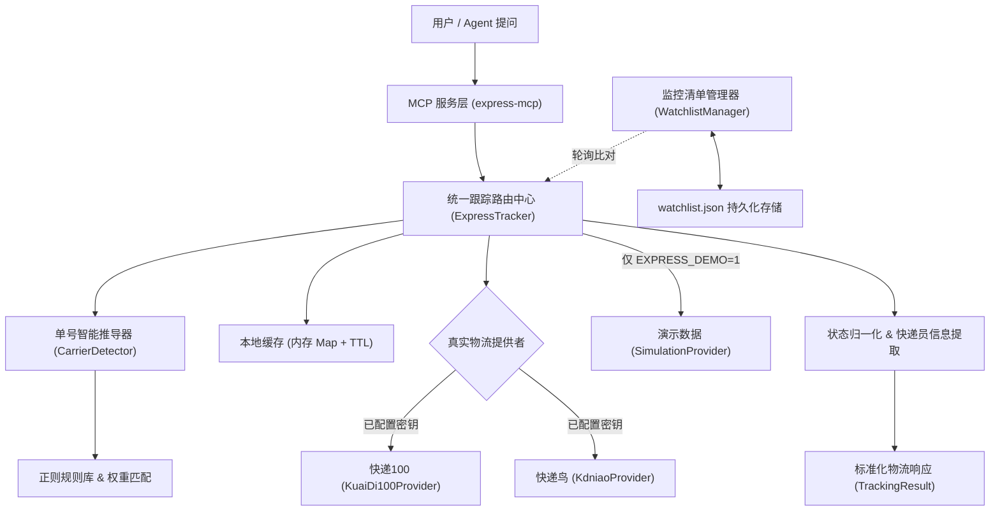
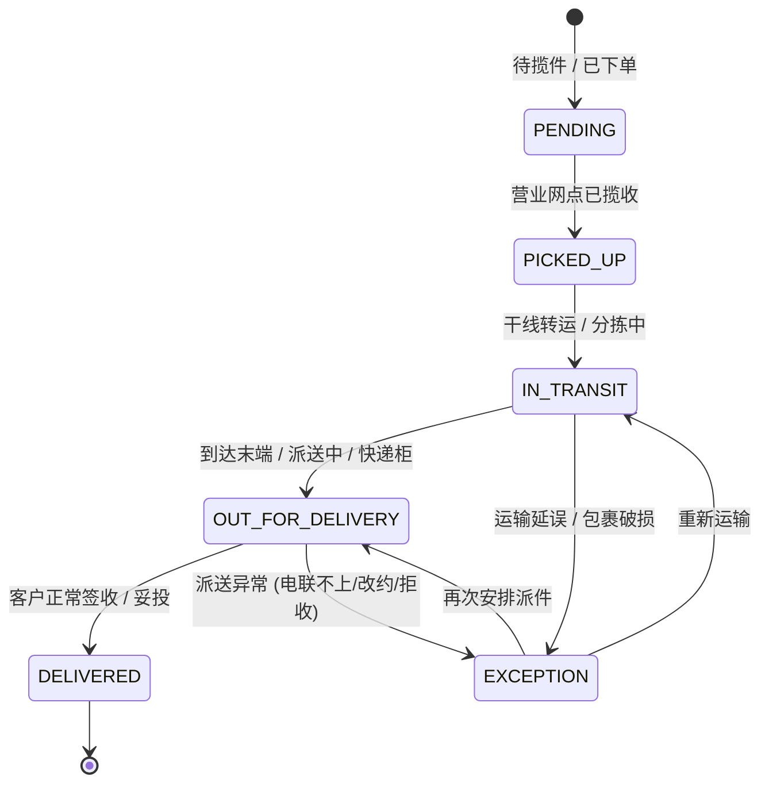

# 快递物流与智能体 (Agent) 接口与协议规范

本规范详细说明本插件如何实现运单智能推导、多源接口调度、标准化状态机归一化以及 MCP 协议与 Agent 的全链路打通。

---

## 1. 架构总览



---

## 2. 标准化物流状态机 (Status Machine)

系统将各大物流服务商差异巨大的返回码与原始文本归一化为 7 种标准状态：



### 状态枚举说明：
- `PENDING`: 电子面单已生成，等待揽件员上门收取。
- `PICKED_UP`: 快递员已成功揽件并录入揽件系统。
- `IN_TRANSIT`: 处于转运中心、分拨中心、干线集装箱运输途中。
- `OUT_FOR_DELIVERY`: 快件已到达目的地营业部，快递员正在派件中，或已放入丰巢/菜鸟驿站等待自提。
- `DELIVERED`: 客户本人凭码或已代签收完成。
- `EXCEPTION`: 派送受阻（电话无人接听、地址不详、客户拒收、包裹破损滞留）。
- `EXPIRED`: 超过 15 天无任何物流状态变动。

---

## 3. MCP 工具接口详细说明

### 3.1 `express_track`
- **功能**：查询单个运单的详细物流轨迹。
- **输入参数**：
  ```json
  {
    "tracking_number": "SF1428571428571",
    "carrier": "sf"
  }
  ```
- **返回数据结构**：
  ```json
  {
    "trackingNumber": "SF1428571428571",
    "carrierCode": "sf",
    "carrierName": "顺丰速运",
    "status": "IN_TRANSIT",
    "statusText": "运输中",
    "isDelivered": false,
    "origin": "广东省广州市",
    "destination": "四川省成都市",
    "courier": {
      "name": "李师傅",
      "phone": "13800138000"
    },
    "latestCheckpoint": {
      "time": "2026-10-14 21:45:00",
      "context": "【广州白云航空集散中心】快件已装车发往【成都双流运转中心】，干线集装箱运输中",
      "status": "IN_TRANSIT"
    },
    "checkpoints": [ ... ],
    "provider": "kuaidi100",
    "updatedAt": "2026-10-14T14:45:00.000Z"
  }
  ```
  未配置 `KUAIDI100_KEY`+`KUAIDI100_CUSTOMER` 或 `KDNIAO_API_KEY`+`KDNIAO_E_BUSINESS_ID` 时，工具返回错误而不是轨迹。真实查询失败同样返回错误。仅当 `EXPRESS_DEMO=1` 时，`provider` 为 `simulator`，并带 `demo: true` 与 `demoLabel`（以 `DEMO DATA` 开头）。

### 3.2 `express_detect_carrier`
- **功能**：识别运单号可能属于的中国快递公司及置信度评分。
- **输入参数**：`{"tracking_number": "JD00123456789"}`
- **返回数据结构**：
  ```json
  {
    "trackingNumber": "JD00123456789",
    "matches": [
      {
        "code": "jd",
        "name": "京东快递",
        "hotline": "950616",
        "confidence": "high",
        "reason": "单号以京东物流专属标识 'JD' 开头"
      }
    ]
  }
  ```

### 3.3 `express_add_watchlist`
- **功能**：添加运单到本地监控清单。
- **输入参数**：
  ```json
  {
    "tracking_number": "SF1428571428571",
    "tag": "机械键盘",
    "carrier": "sf"
  }
  ```

### 3.4 `express_poll_updates`
- **功能**：轮询所有正在监控的包裹，比对返回增量状态变更。
- **返回报告**：
  ```json
  {
    "timestamp": "2026-10-14T15:00:00.000Z",
    "totalWatched": 3,
    "activeCount": 2,
    "deliveredCount": 1,
    "changedCount": 1,
    "changes": [
      {
        "entry": { ... },
        "hasChange": true,
        "changeType": "delivered",
        "oldStatus": "OUT_FOR_DELIVERY",
        "newStatus": "DELIVERED"
      }
    ]
  }
  ```
